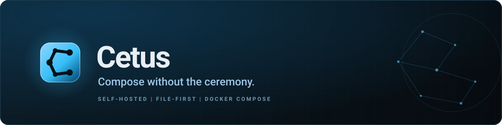
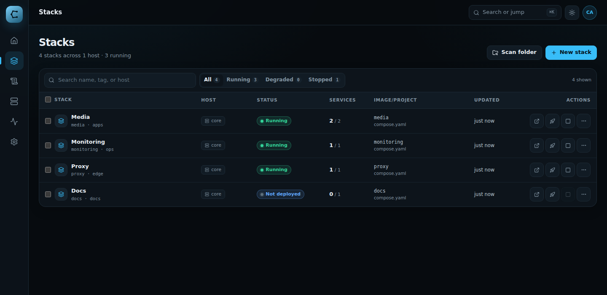
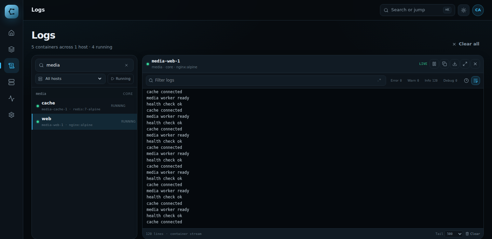
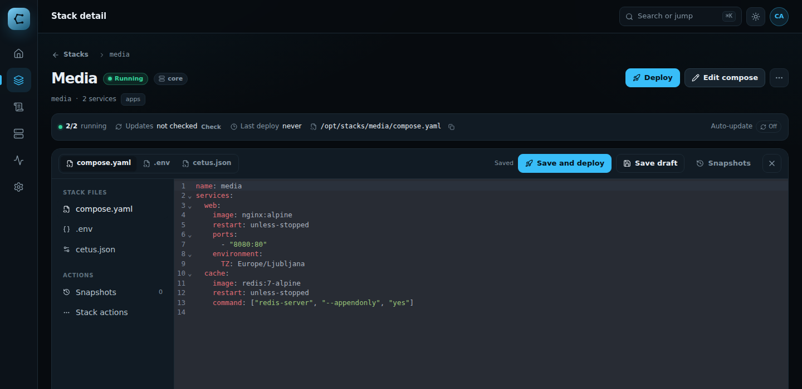
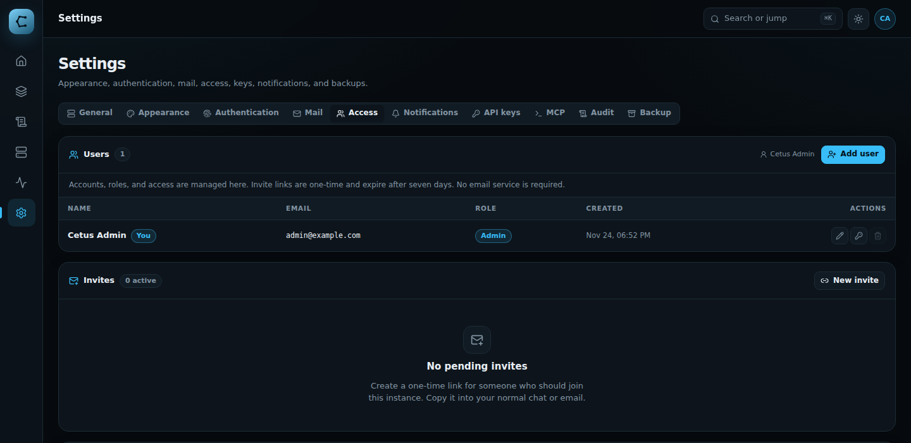
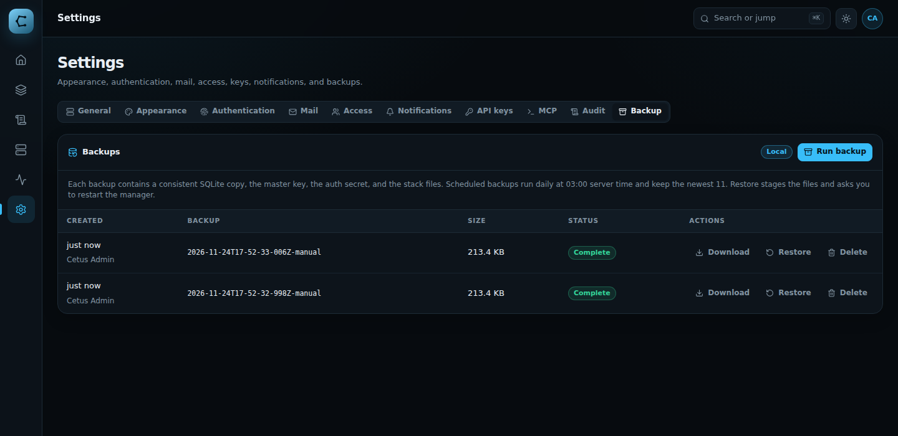

<div align="center">

<a href="https://github.com/zbejas/cetus">
  
</a>

**A compose-native fleet control plane for homelabs.**

One Bun server, one React SPA, file-owned Compose stacks, and every Docker host in one place.

<p>
  <a href="https://github.com/zbejas/cetus/commits/master"></a>
  <a href="https://github.com/zbejas/cetus/issues"></a>
  <a href="https://github.com/zbejas/cetus/pkgs/container/cetus"></a>
  <a href="docs/README.md"></a>
  <a href="LICENSE"></a>
  
</p>

<p>
  <a href="#quick-start">Quick start</a> |
  <a href="#screens">Screens</a> |
  <a href="docs/api.md">API</a> |
  <a href="docs/README.md">Docs</a> |
  <a href="#development">Development</a>
</p>

</div>

---

## Screens



**Stacks.** File-first Compose projects across local and remote Docker hosts, with status, services, host, image, and per-stack actions.



**Logs.** One workspace for every container. Split panes, regex and level filters, timestamps, pause, copy, download, and automatic reconnect.



**Compose editor.** Edit the real files, not a database copy. Comments, quoting, and ordering survive a save; snapshots keep the history.



**Access.** Roles, one-time invites, scoped API keys, audit, OIDC, SMTP, and notification channels from one Settings surface.



**Backups.** Consistent database, key, and stack archives on a schedule. Download, restore, and keep the history local.

## What it does

- **File-first.** Every stack stays on disk under the stacks directory. Cetus edits bytes, preserves comments, and keeps snapshots. SQLite is an index, not the source of truth.
- **One fleet.** The manager runs its own Docker host and accepts outbound workers. Enroll a remote host without opening an inbound port.
- **Real Compose.** Edit compose and env files, deploy, update, delete to trash, run service and container actions, and read live logs on local and worker hosts. Fleet and per-stack update schedules support service exclusions.
- **Scoped access.** Password and OIDC sign-in, roles, invites, API keys with host and stack targets, audit, and notifications.
- **Backups.** A consistent SQLite copy, the master key, and the stack files in one archive. Schedule daily, download, and restore on the next start.
- **Agent-ready.** MCP runs over the same scoped keys, so an AI client sees exactly what the key allows. The generated OpenAPI reference is at `/api/docs`.

## Quick start

```bash
git clone https://github.com/zbejas/cetus.git
cd cetus
docker compose -f compose/manager.yaml up -d
```

Open `http://localhost:3000`. Set `CETUS_ADMIN_EMAIL` and `CETUS_ADMIN_PASSWORD` in `compose/manager.yaml` before first boot. The manager needs `/var/run/docker.sock` and `/opt/stacks`.

Or download the latest `manager.yaml` from [Releases](https://github.com/zbejas/cetus/releases). Runtime settings live in SQLite at `/settings`; see [Settings](docs/settings.md) for bootstrap values and restart boundaries.

## Worker mode

Workers dial out over one WebSocket. No inbound ports. Create a token on **Hosts > Add worker**, then run `compose/worker.yaml` with `CETUS_MANAGER_URL` and `CETUS_ENROLL_TOKEN`. See [Worker mode](docs/worker.md) for the protocol and limits.

## Docs

- [Architecture](docs/architecture.md): topology, request flow, data ownership, auth, schedulers.
- [API and MCP](docs/api.md): REST conventions, OpenAPI, the API explorer, MCP tools, scopes.
- [Backups](docs/backups.md): archive contents, schedule, retention, restore.
- [Development](docs/development.md): setup, commands, gates, and common changes.
- [Settings](docs/settings.md): bootstrap environment, users, OIDC, SMTP, notifications, palettes.
- [Worker mode](docs/worker.md): enrollment, protocol, remote capabilities, limits.
- [Fleet logs](docs/logs.md): log workspace, streaming path, retries, limits.
- [Updates](docs/updates.md): registry checks, schedules, health gate, rollback.
- [Releases](docs/releases.md): versioning, CI, GHCR tags, manual rebuilds.
- [Decisions](docs/decisions.md): locked product, architecture, security, and delivery decisions.
- [Docs index](docs/README.md): the full knowledge base.

## Development

```bash
bun install
bun run dev:all
```

Open `http://localhost:5173`. The API listens on `:3000`, Vite proxies `/api` and `/mcp`, and the production build writes `dist/web`.

Before a change is done:

```bash
bun run typecheck
bun run test
bun run build:web
bun run test:e2e
bun run test:visual
```

See [Development](docs/development.md) for the full command and test reference, and [AGENTS.md](AGENTS.md) for task routing.

## Status

Cetus v1 is usable for a homelab fleet: file-first stacks, multi-host workers, scoped access, updates, backups, OpenAPI, and an MCP surface with the same permissions.

Post-v1: passkeys and TOTP, remote PTY terminals, and a first-party CLI.

## License

MIT. See [LICENSE](LICENSE).
